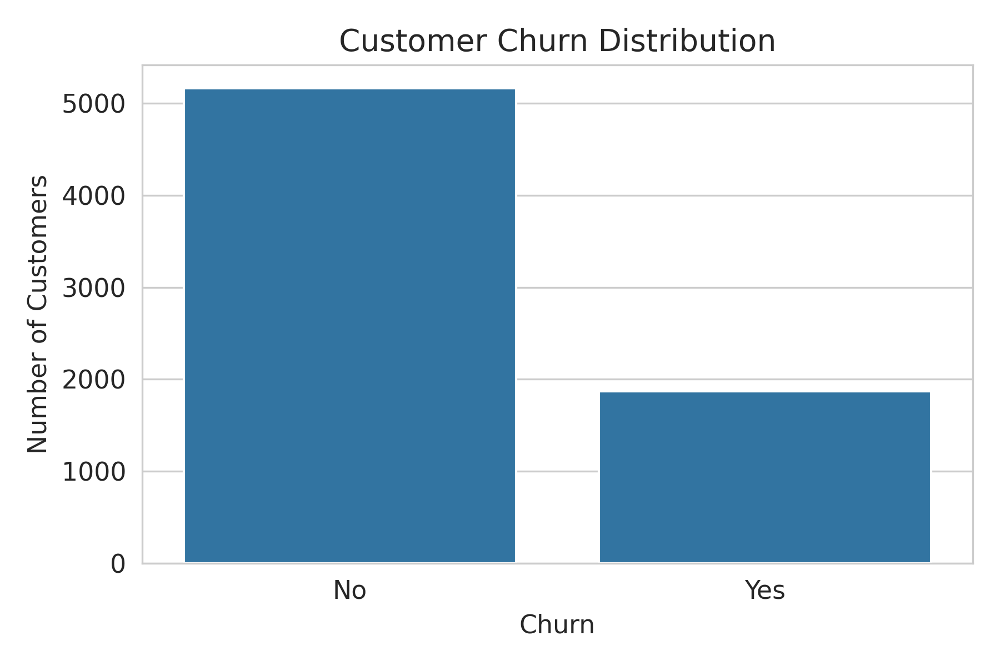
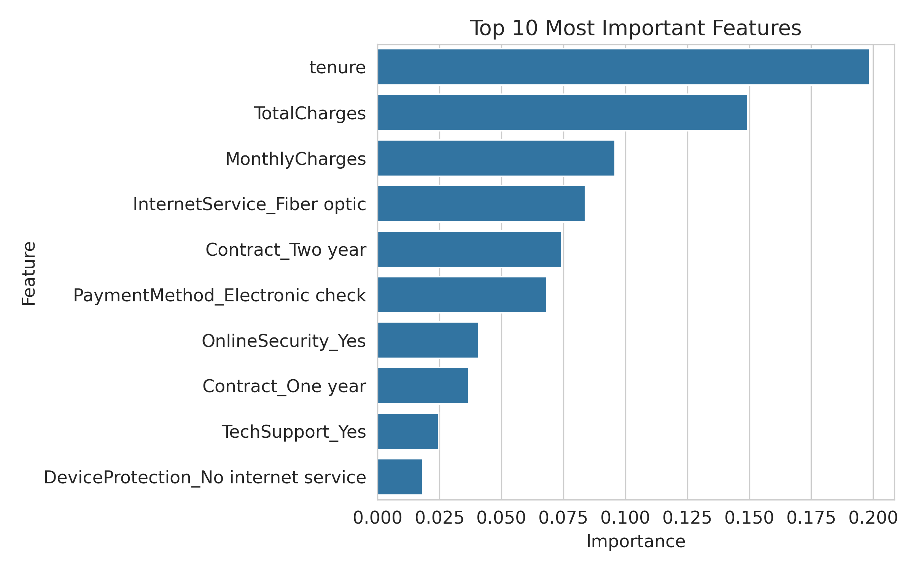

# Customer Churn Prediction Using Machine Learning

An end-to-end machine learning project to predict customer churn using the **IBM Telco Customer Churn dataset**. This project demonstrates the complete analytics workflow, including **data cleaning, exploratory data analysis (EDA), feature engineering, predictive modeling, model evaluation, and business interpretation**.

---

## Project Overview

Customer churn is one of the most important challenges for subscription-based businesses because losing existing customers directly impacts revenue and customer lifetime value (CLV).

The objective of this project is to build a classification model that predicts whether a customer will churn and identify the factors that contribute most to churn behavior.

### Project Summary

| Metric             | Value                    |
| ------------------ | ------------------------ |
| Dataset            | IBM Telco Customer Churn |
| Customers Analyzed | 7,032                    |
| Churn Rate         | 26.6%                    |
| Best Model         | Logistic Regression      |
| Accuracy           | **80.5%**                |
| ROC AUC            | **0.836**                |

---

## Project Workflow

The analysis follows a structured machine learning pipeline:

1. Data cleaning
2. Exploratory data analysis (EDA)
3. Feature engineering
4. Logistic Regression
5. Random Forest
6. Model comparison
7. Feature importance analysis
8. Business insights

---

## Exploratory Data Analysis

### Customer Churn Distribution



### Key Findings from EDA

* **26.6% of customers churned**
* Customers with **shorter tenure** were significantly more likely to churn
* Customers with **higher monthly charges** showed a higher probability of churn
* Long-term customers were much more likely to remain active

---

## Machine Learning Models

Two classification models were developed and evaluated.

| Model               |  Accuracy |   ROC AUC |
| ------------------- | --------: | --------: |
| Logistic Regression | **0.805** |     0.836 |
| Random Forest       |     0.791 | **0.838** |

The Logistic Regression model achieved the best balance between predictive performance and churn detection, making it the preferred model for customer retention analysis.

---

## Feature Importance

The Random Forest model identified the following variables as the strongest predictors of churn.



### Top Predictive Features

* **Tenure**
* **TotalCharges**
* **MonthlyCharges**
* **InternetService (Fiber Optic)**
* **Contract Type**

---

## Business Insights

The analysis suggests that customer churn is primarily driven by **customer tenure, pricing, and contract structure**.

### Key Business Insights

* Customers with **short tenure** are at the highest risk of churn
* **Higher monthly charges** increase churn probability
* Customers with **two-year contracts** are significantly less likely to churn
* Fiber optic customers require closer monitoring due to their higher churn importance

### Business Implications

The company should prioritize:

* **Early retention campaigns** for new customers
* **Contract renewal strategies**
* **Targeted retention programs** for high-value customers
* **Pricing and service optimization** for fiber optic segments

These actions could reduce churn and improve customer lifetime value (CLV).

---

## Tools and Libraries

* Python
* Pandas
* NumPy
* Matplotlib
* Seaborn
* Scikit-learn

---

## Repository Structure

```text
customer-churn-prediction/
├── Customer_Churn_Prediction.ipynb
├── churn_distribution.png
├── feature_importance.png
└── README.md
```

---

## How to Run

1. Clone this repository
2. Open `Customer_Churn_Prediction.ipynb` in Jupyter Notebook or Google Colab
3. Install the required Python libraries
4. Run the notebook from top to bottom

---

## Project Highlights

* End-to-end machine learning workflow
* Business-oriented churn analysis
* Comparative model evaluation
* Feature importance interpretation
* Actionable customer retention insights

---

This project was created as part of my **Data Analytics and Consumer Insight portfolio**, focusing on predictive modeling, customer analytics, and business decision support.

---

# Author

**Umiwithdata*

Market Research | Consumer Insight | Data Analytics

**GitHub:** https://github.com/umiwithdata

